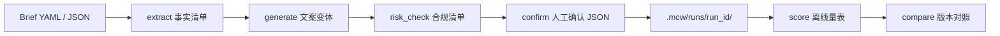

# marketing-content-workflow

[](https://github.com/KDB1223/marketing-content-workflow/actions/workflows/ci.yml)
[](LICENSE)
[](https://www.python.org/downloads/)

**Auditable Brief → extract → generate → risk-check → confirm for Chinese marketing copy, with an offline rubric that is not a conversion rate.**

A local-first Python package and CLI. The Brief is a structured contract (audience, selling points, channel, conversion goal). Each stage writes JSON the next stage is allowed to see. `MockGenerator` keeps demos and CI offline; an OpenAI-compatible client is optional.

中文说明：[README.zh-CN.md](README.zh-CN.md) · 实验手册：[docs/lab-zh.md](docs/lab-zh.md)

## Quickstart

```bash
python3 -m pip install -e ".[dev]"
python3 -m mcw run briefs/sunscreen-xhs.yaml --mock --run-id demo-sunscreen
python3 -m mcw score --fixtures
python3 -m mcw list-versions demo-sunscreen
python3 -m mcw list-runs
```

No API key. A run finishes in seconds and writes `.mcw/runs/demo-sunscreen/`:

```text
run_id: demo-sunscreen
version: v1
backend: mock
brief: 夏季防晒乳小红书种草 (sunscreen-xhs)
approval: pending
A | 痛点切入 | chars 144 | overall 100 | high 0
B | 卖点清单 | chars 131 | overall 100 | high 0
C | 场景故事 | chars 149 | overall 100 | high 0
best: v1-a
```

The number is an offline content score: consistency with the Brief, channel shape, compliance risk, and readability. A business conversion rate still comes from a live experiment. Every score file carries the same boundary:

> 离线内容分只评估文案与 Brief 的一致性、渠道形态、合规风险和可读性。它不是真实投放转化率，也不能代替 A/B 实验或业务结果。

## Workflow



| Stage | What it may use | Artifact |
| --- | --- | --- |
| extract | The Brief only. Deterministic projection, no model. | `extracted.json` |
| generate | The fact sheet and the recorded prompt template. | `drafts.json`, `prompts.json` |
| risk_check | Draft text plus fact sheet. Fixed rules. | `checklist.json` |
| confirm | A reviewer JSON file, or a pending stub. | `approval.json` |
| score | Same inputs as the checklist. Pure function. | `scores.json`, `report.md` |

Re-running `mcw score --run <id>` recomputes the rubric from the saved draft. A mismatch exits 1, so a silent edit to the score file does not pass CI.

`examples/iterate.sh` appends v2 with a reviewer comment and writes `compare-v1-v2.md`. The diff is a content-score delta. It is not lift.

## Offline rubric

Weights: 卖点准确 0.35, 渠道适配 0.25, 合规 0.25, 可读性 0.15. `mcw score --fixtures` replays seven frozen drafts. The recorded totals are:

| Fixture | 卖点准确 | 渠道适配 | 合规 | 可读性 | Total |
| --- | ---: | ---: | ---: | ---: | ---: |
| clean-xiaohongshu | 100 | 100 | 100 | 100 | 100 |
| absolute-claim | 100 | 100 | 75 | 100 | 94 |
| missing-disclaimer | 100 | 100 | 75 | 100 | 94 |
| official-slang | 100 | 80 | 100 | 100 | 95 |
| partial-selling-point | 33 | 100 | 100 | 100 | 77 |
| missed-selling-points | 0 | 100 | 100 | 100 | 65 |
| dense-sentence | 100 | 100 | 100 | 85 | 98 |

`absolute-claim` loses 25 compliance points for `全网第一`. `official-slang` loses 20 channel-fit points for `家人们` on an official page. Neither row is a prediction of clicks or approvals. The formula, exceptions (`第一位` is ingredient order, not a superlative), and the split between checklist rules and score dimensions are in [docs/lab-zh.md](docs/lab-zh.md).

## CLI

| Command | Purpose |
| --- | --- |
| `mcw run <brief> --mock` | New run, version `v1` |
| `mcw run <brief> --mock --continue-run <id> --reviewer <name> --comment <text> --approval <file>` | Next version plus a file-based decision |
| `mcw score --fixtures` | Replay the rubric. Exit 1 if a number moved |
| `mcw score --run <id> [--version v1]` | Recompute a saved run |
| `mcw score --brief <file> --draft <file>` | Score one text file |
| `mcw compare <id> --left v1 --right v2` | Side-by-side comments, scores, and a text diff |
| `mcw list-versions <id>` | Version index with reviewer comments |
| `mcw list-runs` | Saved runs: latest version, approval, and the stored offline score |

`--json` is available on every command. `--variants` accepts 1–5. Run ids are a single path segment (`^[A-Za-z0-9][A-Za-z0-9._-]{0,80}$`).

`mcw list-runs` only reads `manifest.json` and `versions.json` under `.mcw/runs/`. It does not call a model. The overall value is the stored offline content score of the recommended draft, not a conversion rate.

## Briefs

Five Chinese scenarios live in [`briefs/`](briefs/):

| File | Channel | Pressure |
| --- | --- | --- |
| `sunscreen-xhs.yaml` | 小红书 | Cosmetic claims, no medical whitening |
| `coffee-wechat.yaml` | 微信公众号 | Subscription facts, no health claims |
| `fitness-douyin.yaml` | 抖音 | Short hook, no weight-loss promise |
| `creditcard-official.yaml` | 官网 | Fee table, approval is not guaranteed |
| `kidsnack-ecommerce.json` | 电商详情 | Allergen line, `第一位` means first ingredient |

The normalized fields are `product`, `audience`, `channel`, `conversion`, and `constraints` (`must_include`, `must_avoid`, `forbidden_claims`, `regulatory_notes`).

## Layout

```text
briefs/                 example Briefs
src/mcw/schema.py       YAML/JSON validation
src/mcw/stages/         extract, generate, risk_check, confirm
src/mcw/risk/rules.py   absolute words, overclaim, disclaimer, channel heuristics
src/mcw/scoring/        rubric and version compare
src/mcw/llm/            MockGenerator and OpenAI-compatible client
src/mcw/fixtures/       frozen drafts for mcw score --fixtures
examples/               quickstart, iteration, Python API
docs/lab-zh.md          rubric lab
```

## Optional model backend

```bash
export MCW_LLM_API_KEY=sk-...
export MCW_LLM_BASE_URL=https://api.openai.com/v1   # any compatible /v1
export MCW_LLM_MODEL=gpt-4o-mini
python3 -m mcw run briefs/coffee-wechat.yaml --run-id coffee-live
```

`--mock` always wins, including when a key is present. The key is sent only as an `Authorization` header. Prompts and `.mcw/` artifacts do not store it. Online runs are not claimed to be deterministic; the rubric still is, because it scores the returned text.

`MockGenerator` is a deterministic template for demos and CI. It copies selling points verbatim so the rubric can be replayed. Fluent variation is the job of the compatible backend.

## Development

```bash
python3 -m pip install -e ".[dev]"
pytest -q
```

GitHub Actions runs pytest on Python 3.11 and 3.12, then `mcw run --mock`, `mcw score --fixtures`, `mcw list-versions`, `mcw compare`, and `mcw list-runs`. See [CONTRIBUTING.md](CONTRIBUTING.md).

## License

[MIT](LICENSE)
