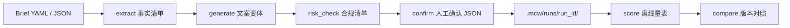

# marketing-content-workflow

[](https://github.com/KDB1223/marketing-content-workflow/actions/workflows/ci.yml)
[](LICENSE)
[](https://www.python.org/downloads/)

**把营销文案收成一条可审计的流水线：Brief → 提取 → 生成 → 风险检查 → 人工确认，并用离线量表打分。这个分数不是投放转化率。**

本地优先的 Python 包和 CLI。Brief 写清受众、卖点、渠道和转化目标。每一阶段只把结构化产物交给下一阶段。演示和 CI 用 `MockGenerator`，不需要 API key；需要时再接 OpenAI 兼容接口。

English overview: [README.md](README.md) · 动手手册：[docs/lab-zh.md](docs/lab-zh.md)

## 一分钟开始

```bash
python3 -m pip install -e ".[dev]"
python3 -m mcw run briefs/sunscreen-xhs.yaml --mock --run-id demo-sunscreen
python3 -m mcw score --fixtures
python3 -m mcw list-versions demo-sunscreen
```

产物在 `.mcw/runs/demo-sunscreen/`。Mock 写出的小红书变体 A 是这样的：

```text
夏天出油怕搓泥？看看澄光防晒乳 SPF50+

18-28 岁都市通勤族如果也被「夏天出油怕搓泥」卡住，可以先核对这几条事实。轻薄不油腻，上脸成膜快；SPF50+ PA++++；添加积雪草，舒缓晒后泛红。评论区扣「防晒」领取试用装说明。
【声明】防晒效果因人而异，长时间外出请及时补涂。
#小红书 #护肤
```

三条变体的离线总分都是 100，高风险项为 0。100 分的意思是：卖点原句在、渠道组件在、声明在、没有绝对化用语。分数文件里的原句是：

> 离线内容分只评估文案与 Brief 的一致性、渠道形态、合规风险和可读性。它不是真实投放转化率，也不能代替 A/B 实验或业务结果。

## 流水线



| 阶段 | 允许看到的输入 | 产物 |
| --- | --- | --- |
| extract | 只读 Brief，做确定性投影，不调用模型 | `extracted.json` |
| generate | 事实清单 + 记入档案的提示词模板 | `drafts.json`、`prompts.json` |
| risk_check | 文案正文 + 事实清单，规则固定 | `checklist.json` |
| confirm | 审阅人 JSON；不传就写 pending 存根 | `approval.json` |
| score | 与清单相同的输入，纯函数 | `scores.json`、`report.md` |

同一 run 可以续写。`examples/iterate.sh` 会在信用卡权益页上追加 v2，把审阅备注和确认文件写进 `versions.json`，再生成 `compare-v1-v2.md`。对照表里的加减分是内容分变化，页面上写明了不能把它当成转化提升。

`mcw score --run <id>` 会按存档正文重算。数字对不上时退出码为 1。

## 离线量表

权重：卖点准确 0.35，渠道适配 0.25，合规 0.25，可读性 0.15。`mcw score --fixtures` 复放七篇冻结稿，分数如下。

| 用例 | 卖点准确 | 渠道适配 | 合规 | 可读性 | 总分 |
| --- | ---: | ---: | ---: | ---: | ---: |
| clean-xiaohongshu | 100 | 100 | 100 | 100 | 100 |
| absolute-claim | 100 | 100 | 75 | 100 | 94 |
| missing-disclaimer | 100 | 100 | 75 | 100 | 94 |
| official-slang | 100 | 80 | 100 | 100 | 95 |
| partial-selling-point | 33 | 100 | 100 | 100 | 77 |
| missed-selling-points | 0 | 100 | 100 | 100 | 65 |
| dense-sentence | 100 | 100 | 100 | 85 | 98 |

`absolute-claim` 因为「全网第一」在合规上扣 25 分。`official-slang` 因为官网出现「家人们」，渠道适配扣 20 分。两行都只描述文案和 Brief 的差距。公式、`第一位` 这类例外，以及清单规则和分数维度的分工，写在 [docs/lab-zh.md](docs/lab-zh.md)。

## 命令

| 命令 | 作用 |
| --- | --- |
| `mcw run <brief> --mock` | 新建运行，版本 `v1` |
| `mcw run <brief> --mock --continue-run <id> --reviewer <姓名> --comment <备注> --approval <文件>` | 追加版本，并记录人工确认 |
| `mcw score --fixtures` | 复放量表；分数变化则退出码 1 |
| `mcw score --run <id> [--version v1]` | 重算某次存档 |
| `mcw score --brief <文件> --draft <文件>` | 给一篇纯文本打分 |
| `mcw compare <id> --left v1 --right v2` | 备注、分数和正文 diff |
| `mcw list-versions <id>` | 列出版本和审阅备注 |

每个命令都可以加 `--json`。`--variants` 取 1 到 5。run id 只能是一段路径名。

## 五则中文 Brief

| 文件 | 渠道 | 这条 Brief 在管什么 |
| --- | --- | --- |
| `briefs/sunscreen-xhs.yaml` | 小红书 | 防晒规格可以写，医疗级美白不能写 |
| `briefs/coffee-wechat.yaml` | 微信公众号 | 烘焙日期和配送，不写成保健品 |
| `briefs/fitness-douyin.yaml` | 抖音 | 短钩子，不承诺瘦 |
| `briefs/creditcard-official.yaml` | 官网 | 权益以费率表和审批为准 |
| `briefs/kidsnack-ecommerce.json` | 电商详情 | 年龄和过敏原；「配料表第一位」是原料顺序 |

字段是 `product`、`audience`、`channel`、`conversion`、`constraints`。`constraints` 里有 `must_include`、`must_avoid`、`forbidden_claims`、`regulatory_notes`。

## 目录

```text
briefs/                 示例 Brief
src/mcw/schema.py       YAML/JSON 校验
src/mcw/stages/         extract / generate / risk_check / confirm
src/mcw/risk/rules.py   绝对化、夸大、声明、渠道形态
src/mcw/scoring/        量表和版本对照
src/mcw/llm/            MockGenerator 与 OpenAI 兼容客户端
src/mcw/fixtures/       mcw score --fixtures 的冻结稿
examples/               快速开始、续写、Python API
docs/lab-zh.md          量表实验
```

## 可选的在线模型

```bash
export MCW_LLM_API_KEY=sk-...
export MCW_LLM_BASE_URL=https://api.openai.com/v1
export MCW_LLM_MODEL=gpt-4o-mini
python3 -m mcw run briefs/coffee-wechat.yaml --run-id coffee-live
```

只要带了 `--mock`，就不会访问网络。密钥只放在 `Authorization` 头里，不写入提示词和 `.mcw/`。在线生成不保证逐字复现；量表仍然只看最终正文，所以打分可以复现。

`MockGenerator` 是给演示和 CI 用的确定性模板，卖点按原句填入。它不是文案质量的上限。更顺的句子交给兼容接口。

## 开发与许可

```bash
python3 -m pip install -e ".[dev]"
pytest -q
```

GitHub Actions 在 Python 3.11 和 3.12 上跑 pytest，再跑一遍 `mcw run --mock`、`mcw score --fixtures`、`mcw list-versions` 和 `mcw compare`。贡献方式见 [CONTRIBUTING.md](CONTRIBUTING.md)。

[MIT](LICENSE)
